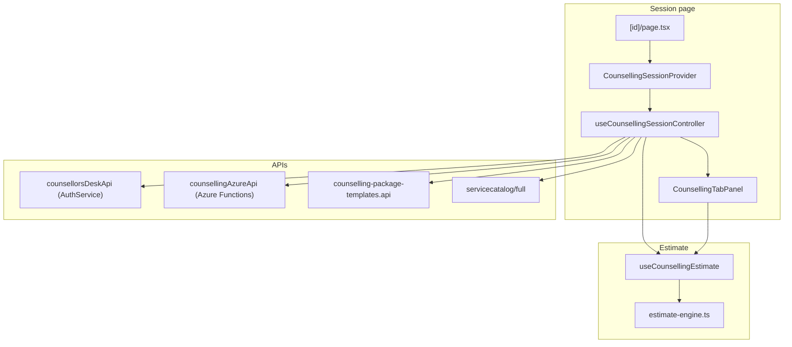

# Counselling desk — data flow (Phase 0)

## Architecture overview

## Load path

1. `useCounsellingSessionQuery(sessionId)` → AuthService counselling session DTO.
2. `counsellingAzureApi.getRecord` + `getPriceOverrides` enrich package/override state.
3. `parseEstimateFromBlob(package_addons_json)` restores `estimateMode`, `packageTemplateId`, discount fields.
4. When `estimateMode === 'package'` and templates are loaded, `restorePackage(packageTemplateId)` re-hydrates procedure, eye, IOL, investigations (guarded by `packageRestoredRef`).

## Save path

1. Validation in controller (procedure, eye, sub-type/IOL, discount reason if discount &gt; 0).
2. `saveCounsellingSession` → `counsellorsDeskApi.saveSession` with `mergeEstimateIntoBlob(...)`.
3. Investigations → `saveInvestigations`.
4. Azure blob → `counsellingAzureApi.save` (package details JSON uses `finalPayableAmount` when set).
5. Decision / schedule / OT upsert as before.

## API environment checklist

| Endpoint | Service | Used for |
|----------|---------|----------|
| `GET/PUT /api/counselling-sessions/{id}` | AuthService | Session load/save, investigations |
| `GET/POST/PUT/DELETE /api/counselling-package-templates` | AuthService | Package master data |
| `GET/PUT /api/counselling-package-templates/settings` | AuthService | Tenant max discount % / flat cap |
| `GET /api/servicecatalog/full` | AuthService | Procedures, IOL, investigations |
| `GET/POST …/counselling/{id}/*` | Azure counselling API | Lock, history, overrides, decision, schedule |
| `/packagemanagement/*` | Legacy | **Not used** by redesigned counselling desk |

Override env: `NEXT_PUBLIC_COUNSELLING_API_URL` (defaults to local Azure Functions host).

## Single source of truth for estimates

**`useCounsellingEstimate` + `estimate-engine.ts`** — all line items, package savings, discount caps, and `finalPayableAmount`. Legacy `packageRate` is kept for backward compatibility and OT finalize display only; saves prefer `finalPayableAmount`.
