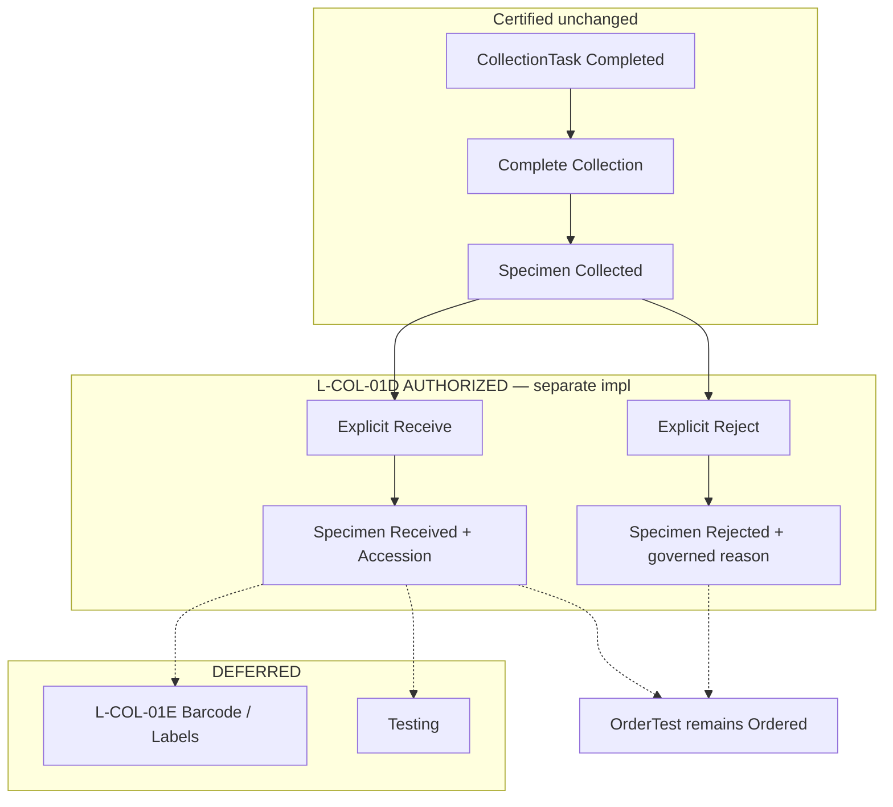

# L-COL-01D — Specimen Receiving & Accession  
# Product Owner Decision Closure

**Date:** 2026-10-10  
**Slice:** L-COL-01D (Receiving & Accession — decision closure only)  
**Mode:** DOCUMENTATION / PRODUCT OWNER APPROVAL ONLY — no application source, schema, migrations, APIs, UI, permissions seeding/grants, CollectionTask, Orders, Catalogue, Pathology, Billing, Testing, barcode, or label implementation  
**Discovery package:** [enterprise-lms-receiving-accession-discovery-audit.md](./enterprise-lms-receiving-accession-discovery-audit.md)  
**Prior Specimen/Receiving baselines:** [enterprise-lms-specimen-receiving-decision-closure.md](./enterprise-lms-specimen-receiving-decision-closure.md) (`PRODUCT_DECISIONS_CLOSED_L_COL_01C_AUTHORIZED`)  
**Authoritative PRD/BRD:** `enterprise_laboratory_management_system_prd_brd.docx` (project Library / functional source of truth — repository copy absence is a **repository gap only**, not a PRD-unavailable condition; PD-COL-REC-24)

```text
L0 · L-CAT-01B · L-ORD-01B · L-ORD-01C · L-COL-01B ACCEPTED
  → L-COL-01C Specimen Foundation + Complete Collection
  → Discovery audit (READY_FOR_PRODUCT_OWNER_APPROVAL)
  ↓
PD-COL-REC-* / AD-COL-REC-* (THIS DOCUMENT)
  ← PRODUCT OWNER APPROVED (2026-10-10)
  ↓
L-COL-01D Receiving & Accession
  ← AUTHORIZED FOR SEPARATE IMPLEMENTATION TASK
  ← NOT IMPLEMENTED BY THIS DOCUMENT
  ↓
Later: L-COL-01E Barcode/Labels → Testing
```

---

## 1. Executive summary

Product Owner has **closed** the blocking Receiving & Accession decisions from the discovery audit.

| Class | Meaning |
|---|---|
| **APPROVED** | Product Owner approved in this closure, or already certified upstream |
| **DEFERRED** | Explicitly out of L-COL-01D; later slice (e.g. L-COL-01E) |
| **CONFIGURATION_REQUIRED** | Governed configuration/master dependency for implementation — **not** invented by engineering |
| **REJECTED** | Explicitly disallowed |

**Gate determination:**

# PRODUCT_DECISIONS_CLOSED_L_COL_01D_AUTHORIZED

**This document does not implement L-COL-01D.**

Certified upstream behavior remains **unchanged**:

```text
CollectionTask Completed  ≠  Specimen Created

CollectionTask Completed
    +
explicit Complete Collection
    =
Specimen Collected

Specimen Collected
    +
explicit Receive (this slice)
    =
Specimen Received (+ accession)

Specimen Collected
    +
explicit Reject (this slice)
    =
Specimen Rejected (reason from governed configuration)
```

---

## 2. Authoritative sources

| Source | Role |
|---|---|
| `enterprise_laboratory_management_system_prd_brd.docx` | Functional SoT (Library). Receiving = accept/reject/triage stage; rejection events reason-coded + actor/timestamp; receiving operational queue; specimen lifecycle includes Collected / Received / Rejected (richer PRD states beyond this slice are deferred) |
| Discovery audit | Open questions closed by this stamp |
| L-COL-01A Specimen/Receiving closure (PD-COL-SPC-*) | Accession at Receiving; LaboratoryApi ownership; barcode deferred; permissions defined |
| L-COL-01B acceptance + UAT | CollectionTask SoT unchanged |
| L-COL-01C implementation + authz + UAT reports | Specimen Collected SoT unchanged |

### PRD alignment (non-exhaustive)

| PRD theme | L-COL-01D closure |
|---|---|
| Distinct Receiving role/queue; accept/reject with reason + actor/timestamp | Explicit Receive/Reject; governed rejection reason; audit |
| Specimen lifecycle includes Collected → Received / Rejected | Introduce Received + Rejected on LMS Specimen |
| Labels/barcode as collection/receiving logistics | **DEFERRED** to L-COL-01E (bounded first receive/accession) |
| Hold / aliquot / custody / In Transit | **DEFERRED** (beyond L-COL-01D) |
| Charge/commercial at collection principle (hospital LMS billing model) | No Billing mutation in L-COL-01D |

---

## 3. Certified upstream constraints (immutable)

| Constraint | Status |
|---|---|
| L-COL-01B lifecycle `Planned → Ready → InProgress → Completed`; Completed terminal | **APPROVED** / ACCEPTED |
| Complete Collection → Specimen Collected; no CollectionTask/Order/OrderTest mutation | **APPROVED** (L-COL-01C) |
| Order remains Submitted; OrderTest remains Ordered after collect | **APPROVED** |
| Immutable Specimen GUID | **APPROVED** |
| Pathology `/dashboard/laboratory` not LMS Specimen SoT | **APPROVED** |
| LaboratoryApi owns Specimen/Receiving; no Receiving microservice | **APPROVED** |
| No Billing / Testing / Results in this closure’s implementation authorization | **APPROVED** |
| `lms.collection.view\|manage\|collect` unchanged | **APPROVED** |
| No production role grants in decision/implementation authorization from this document | **APPROVED** |

---

## 4. Product Owner decisions — PD-COL-REC-01 … PD-COL-REC-24

### PD-COL-REC-01 — Receiving trigger

| Field | Content |
|---|---|
| **Status** | **APPROVED** |
| **Rule** | Receiving is an **explicit mutation** on the existing Specimen. Complete Collection must **not** automatically mark Received |
| **Lifecycle** | CollectionTask Completed → Complete Collection → Specimen Collected → **Explicit Receive** → Specimen Received |

### PD-COL-REC-02 — Receiving eligibility

| Field | Content |
|---|---|
| **Status** | **APPROVED** |
| **Rule** | Receive allowed only when Specimen status = **Collected**, underlying Order = **Submitted**, linked OrderTests = **Ordered**. Server-side validation mandatory |
| **OrderTest** | Receiving **MUST NOT** change OrderTest state in L-COL-01D |

### PD-COL-REC-03 — Received state

| Field | Content |
|---|---|
| **Status** | **APPROVED** |
| **Rule** | Introduce Specimen state **Received**. Transition **Collected → Received**, server-enforced |

### PD-COL-REC-04 — Rejected state

| Field | Content |
|---|---|
| **Status** | **APPROVED** |
| **Rule** | Introduce Specimen state **Rejected** when specimen cannot be accepted. Transition **Collected → Rejected**. Rejected remains visible and auditable. Must **not** silently return to Collected |
| **Recollection** | New CollectionTask + new Specimen; original Specimen remains historical (aligns PD-COL-SPC-11) |

### PD-COL-REC-05 — Rejection reason

| Field | Content |
|---|---|
| **Status** | **APPROVED** (requirement) + **CONFIGURATION_REQUIRED** (master source) |
| **Rule** | Rejection reason is **mandatory** on Reject. Reason must come from a **governed configuration/master** source. Engineering must **not** invent a hard-coded clinical/operational rejection catalogue |
| **Implementation dependency** | If repository lacks an LMS-governed rejection-reason master at implementation time, treat as **configuration dependency** (candidate reuse patterns may include platform MasterValue / future LMS config — selection is an implementation design under this constraint, not a license to invent codes). Catalogue `RejectionCriteria` text remains **guidance only**, not the rejection SoT |

### PD-COL-REC-06 — Receiving branch

| Field | Content |
|---|---|
| **Status** | **APPROVED** |
| **Rule** | Receiving is **branch-authorized**. Actor must be authorized for the branch in which the receive/reject operation is performed. Reuse existing platform branch authorization (`validate-user-branch` pattern) |
| **Out** | No cross-branch receiving in L-COL-01D. No new laboratory/site hierarchy |

### PD-COL-REC-07 — Receiving location

| Field | Content |
|---|---|
| **Status** | **APPROVED** |
| **Rule** | Optional `LocationText` for first Receiving slice. No room/bed/location master |

### PD-COL-REC-08 — Receiver identity

| Field | Content |
|---|---|
| **Status** | **APPROVED** |
| **Rule** | Receiver = authenticated platform user. Timestamp = **server UTC** (client time never authoritative) |

### PD-COL-REC-09 — Patient identity

| Field | Content |
|---|---|
| **Status** | **APPROVED** |
| **Rule** | Receive UI must explicitly reconfirm **MRN**, **patient name**, and **DOB** before successful Receive. No barcode scanning in L-COL-01D |

### PD-COL-REC-10 — Accession timing

| Field | Content |
|---|---|
| **Status** | **APPROVED** |
| **Rule** | Accession created **only after** successful Receive validation. Sequence: validate → receive → accession → Received. Accession must **never** be created merely because a Specimen is Collected (preserves PD-COL-SPC-04) |

### PD-COL-REC-11 — Accession uniqueness

| Field | Content |
|---|---|
| **Status** | **APPROVED** (uniqueness principle) + **CONFIGURATION_REQUIRED** (exact scope binding) |
| **Rule** | Accession unique within the configured tenant/site scope used by the LMS. Database-enforced uniqueness required. Exact sequence/configuration source must be explicit at implementation |
| **Out** | Do **not** invent accession format in engineering |

### PD-COL-REC-12 — Accession configuration

| Field | Content |
|---|---|
| **Status** | **APPROVED** (configuration principle) + **CONFIGURATION_REQUIRED** (source/format) |
| **Rule** | Accession format/sequence is **configuration**, not hard-coded business logic. Reuse an existing governed configuration source if one exists. If none exists, record **configuration dependency** rather than inventing prefix, date format, check digit, numbering period, or branch numbering scheme |
| **Immutability** | Accession is **immutable** once issued |
| **Pattern note** | LMS already uses tenant-scoped number sequences for Orders/CollectionTasks (`LmsOrderNumberSequence`, `LmsCollectionTaskNumberSequence`). That is a **reuse pattern only** — not an approved accession format |

### PD-COL-REC-13 — Barcode

| Field | Content |
|---|---|
| **Status** | **APPROVED** / implementation **DEFERRED** |
| **Rule** | Barcode ≠ accession. Barcode implementation **DEFERRED** to **L-COL-01E**. No barcode generation in L-COL-01D |

### PD-COL-REC-14 — Labels

| Field | Content |
|---|---|
| **Status** | **APPROVED** / implementation **DEFERRED** |
| **Rule** | Label generation / printing / reprinting **DEFERRED** to **L-COL-01E** |

### PD-COL-REC-15 — Duplicate Receive

| Field | Content |
|---|---|
| **Status** | **APPROVED** |
| **Rule** | Operation-specific idempotency. Same key + same request hash → replay. Same key + different hash → idempotency conflict. Already-Received Specimen must not create another accession. HTTP/error semantics reuse existing LMS conventions |

### PD-COL-REC-16 — Concurrency

| Field | Content |
|---|---|
| **Status** | **APPROVED** |
| **Rule** | Optimistic concurrency (`ExpectedRowVersion` / `RowVersion`). Concurrent mutation → established `409 concurrency_conflict`. Accession uniqueness also database-enforced |

### PD-COL-REC-17 — Audit

| Field | Content |
|---|---|
| **Status** | **APPROVED** |
| **Rule** | Platform `audit_log` sole SoT. Fail-closed mutations. Actions: **`RECEIVE_SPECIMEN`**, **`REJECT_SPECIMEN`**. Accession creation may be represented within `RECEIVE_SPECIMEN` unless existing audit architecture requires a separate `CREATE_ACCESSION` (implementation choice under single audit SoT). No second audit source. Allowlist entries only in the future implementation task |

### PD-COL-REC-18 — Permission

| Field | Content |
|---|---|
| **Status** | **APPROVED** |
| **Rule** | `lms.specimens.view` = read. `lms.specimens.receive` = normal Receive/Reject mutation permission. Do **not** require `lms.specimens.manage` for ordinary Receive/Reject unless architecture proves unavoidable |
| **Unchanged** | `lms.collection.view\|manage\|collect` |
| **Out** | No role grants in this closure |

### PD-COL-REC-19 — Ownership

| Field | Content |
|---|---|
| **Status** | **APPROVED** |
| **Rule** | Shared **branch-authorized** operational queue. No Claim, Assign, individual Specimen ownership, or Counsellor-style ownership. Visibility ≠ ownership |

### PD-COL-REC-20 — Reversal

| Field | Content |
|---|---|
| **Status** | **APPROVED** |
| **Rule** | Do **not** implement `Received → Collected` or `Rejected → Collected`. Future administrative correction = separately governed audited capability |

### PD-COL-REC-21 — Batch receiving

| Field | Content |
|---|---|
| **Status** | **DEFERRED** |
| **Rule** | L-COL-01D receives **one Specimen per operation**. No multi-specimen batch Receive |

### PD-COL-REC-22 — Specimen worklist

| Field | Content |
|---|---|
| **Status** | **APPROVED** |
| **Rule** | When L-COL-01D implementation begins, `/dashboard/lms/specimens` becomes the authoritative Receiving operational worklist. Minimum: Specimen GUID, Accession, MRN/patient name, Order number, status, collection date/time, branch, receiving action. Extend existing read-only detail rather than duplicating |
| **Out of L-COL-01D worklist** | TAT KPIs, dashboards, barcode scan, printing, claim/assign (unless separately approved) |

### PD-COL-REC-23 — Billing

| Field | Content |
|---|---|
| **Status** | **APPROVED** |
| **Rule** | No Billing mutation in L-COL-01D. Preserve specimen collection = commercial charge principle (PD-LAB-BILL-01 / PD-COL-SPC-22). Receiving must not post Finance transactions |

### PD-COL-REC-24 — PRD repository gap

| Field | Content |
|---|---|
| **Status** | **APPROVED** (closed) |
| **Rule** | Repository absence of the PRD/BRD file is a **repository gap only**. Authoritative PRD/BRD in the project Library remains the functional source of truth. Do **not** treat the PRD as unavailable for product decisions |

---

## 5. Architecture decisions — AD-COL-REC-01 … AD-COL-REC-13

| ID | Decision | Status |
|---|---|---|
| AD-COL-REC-01 | LaboratoryApi owns Receiving | **APPROVED** |
| AD-COL-REC-02 | Shared PostgreSQL `hospitalportal` with LMS-owned `lms_*` tables | **APPROVED** |
| AD-COL-REC-03 | Received/Rejected belong to `LmsSpecimen` lifecycle | **APPROVED** |
| AD-COL-REC-04 | Accession persistence/sequence uses governed configuration | **APPROVED** (+ **CONFIGURATION_REQUIRED**) |
| AD-COL-REC-05 | Receive + accession transactionally consistent | **APPROVED** |
| AD-COL-REC-06 | Operation-specific idempotency | **APPROVED** |
| AD-COL-REC-07 | Optimistic concurrency | **APPROVED** |
| AD-COL-REC-08 | Platform `audit_log` | **APPROVED** |
| AD-COL-REC-09 | Existing branch authorization pattern | **APPROVED** |
| AD-COL-REC-10 | No Receiving microservice | **APPROVED** |
| AD-COL-REC-11 | Barcode/labels = separate **L-COL-01E** | **APPROVED** |
| AD-COL-REC-12 | No Pathology coupling | **APPROVED** |
| AD-COL-REC-13 | No Billing mutation | **APPROVED** |

---

## 6. Decision register (compact)

| ID | Status |
|---|---|
| PD-COL-REC-01 | **APPROVED** |
| PD-COL-REC-02 | **APPROVED** |
| PD-COL-REC-03 | **APPROVED** |
| PD-COL-REC-04 | **APPROVED** |
| PD-COL-REC-05 | **APPROVED** + **CONFIGURATION_REQUIRED** |
| PD-COL-REC-06 | **APPROVED** |
| PD-COL-REC-07 | **APPROVED** |
| PD-COL-REC-08 | **APPROVED** |
| PD-COL-REC-09 | **APPROVED** |
| PD-COL-REC-10 | **APPROVED** |
| PD-COL-REC-11 | **APPROVED** + **CONFIGURATION_REQUIRED** |
| PD-COL-REC-12 | **APPROVED** + **CONFIGURATION_REQUIRED** |
| PD-COL-REC-13 | **APPROVED** / impl **DEFERRED** (L-COL-01E) |
| PD-COL-REC-14 | **APPROVED** / impl **DEFERRED** (L-COL-01E) |
| PD-COL-REC-15 | **APPROVED** |
| PD-COL-REC-16 | **APPROVED** |
| PD-COL-REC-17 | **APPROVED** |
| PD-COL-REC-18 | **APPROVED** |
| PD-COL-REC-19 | **APPROVED** |
| PD-COL-REC-20 | **APPROVED** |
| PD-COL-REC-21 | **DEFERRED** |
| PD-COL-REC-22 | **APPROVED** |
| PD-COL-REC-23 | **APPROVED** |
| PD-COL-REC-24 | **APPROVED** (repository gap closed) |
| AD-COL-REC-01 … AD-COL-REC-13 | **APPROVED** |

**No remaining DECISION_REQUIRED items for Product Owner product rules.**  
Implementation remains blocked only on **CONFIGURATION_REQUIRED** dependencies (rejection-reason master; accession sequence/format/scope configuration) — to be resolved in the implementation task by binding to governed sources, **not** by inventing masters.

---

## 7. State machine (APPROVED for L-COL-01D)



**Forbidden in L-COL-01D:** `Received → Collected`, `Rejected → Collected`, auto-receive on Complete Collection, accession at Collect.

---

## 8. L-COL-01D authorization

| Field | Content |
|---|---|
| **Slice** | L-COL-01D — Specimen Receiving & Accession |
| **Authorization** | **AUTHORIZED FOR SEPARATE IMPLEMENTATION TASK** |
| **This document** | Does **not** implement L-COL-01D |
| **Next step** | Separate Cursor / engineering implementation task against this closure |
| **Configuration prerequisites** | Governed rejection-reason source; governed accession sequence/format/uniqueness scope |

---

## 9. Exact L-COL-01D implementation boundary

### IN SCOPE (future implementation task only)

- Specimen states **Received** and **Rejected**
- Explicit **Receive** and **Reject** operations
- Governed rejection-reason dependency (mandatory on Reject)
- Accession creation after successful receive validation
- Accession uniqueness (DB-enforced) + governed configuration binding
- Receiving branch authorization (no cross-branch)
- Optional receiving `LocationText`
- Authenticated receiver + server UTC
- Patient reconfirmation (MRN / name / DOB)
- Order Submitted + OrderTest Ordered validation (no OT state change)
- Permission: `lms.specimens.receive` for Receive/Reject; `lms.specimens.view` for read
- Shared Specimen Receiving worklist on `/dashboard/lms/specimens`
- Extend existing Specimen detail
- Idempotency, concurrency, platform audit
- Automated tests + manual UAT

### OUT OF SCOPE

- Barcode · labels · printers · barcode scanning (**L-COL-01E**)  
- Batch receiving  
- Claim / Assign / Specimen ownership  
- Custody graph · aliquots · referral direct receive  
- Hold / In Transit / Conditionally Accepted (PRD-richer states)  
- Testing · Results · Verification · Authorization · Reporting  
- Billing execution · Finance mutation  
- Pathology migration / coupling  
- Production role grants  
- TAT/KPI dashboards  
- Invented rejection catalogues or accession formats  

---

## 10. Permissions (definitions — no grants)

| Code | L-COL-01D use |
|---|---|
| `lms.specimens.view` | Worklist / detail read |
| `lms.specimens.receive` | Receive and Reject mutations |
| `lms.specimens.manage` | Not required for ordinary Receive/Reject |
| `lms.collection.*` | Unchanged; not redefined for Receiving |

**No role grants** in this closure or by this document’s authorization alone.

---

## 11. Traceability

| Upstream | Effect |
|---|---|
| L-COL-01B / 01C | Unchanged; Receive is additive after Collected |
| PD-COL-SPC-04 / 17 / 18 | Accession at Receiving; LaboratoryApi owns Receiving; Received/Rejected now authorized for 01D |
| PD-COL-SPC-05 | Barcode still deferred → L-COL-01E |
| PD-COL-SPC-11 | Recollection = new task + Specimen |
| PD-COL-SPC-16 | Permission definitions; no role grants |
| PD-COL-SPC-22 / PD-LAB-BILL-01 | No Billing in Receiving |
| PRD Receiving / rejection / worklist | Aligned; Hold/aliquot/scan deferred beyond slice |
| Discovery audit §24 | Closed by PD-COL-REC-* above |

---

## 12. Confirmation — this task

- NO APPLICATION IMPLEMENTATION  
- NO DATABASE / MIGRATION  
- NO API IMPLEMENTATION  
- NO UI IMPLEMENTATION  
- NO RECEIVING / ACCESSION / BARCODE / LABEL IMPLEMENTATION  
- NO ROLE GRANTS  
- NO PATHOLOGY / ORDERS / CATALOGUE / COLLECTION BEHAVIOR CHANGES  
- NO BILLING / TESTING IMPLEMENTATION  

---

## FINAL STATUS

**PRODUCT_DECISIONS_CLOSED_L_COL_01D_AUTHORIZED**

**L-COL-01D = AUTHORIZED FOR SEPARATE IMPLEMENTATION TASK**

**STOP.** Do not implement L-COL-01D in this task. Do not generate the implementation prompt in this task.
