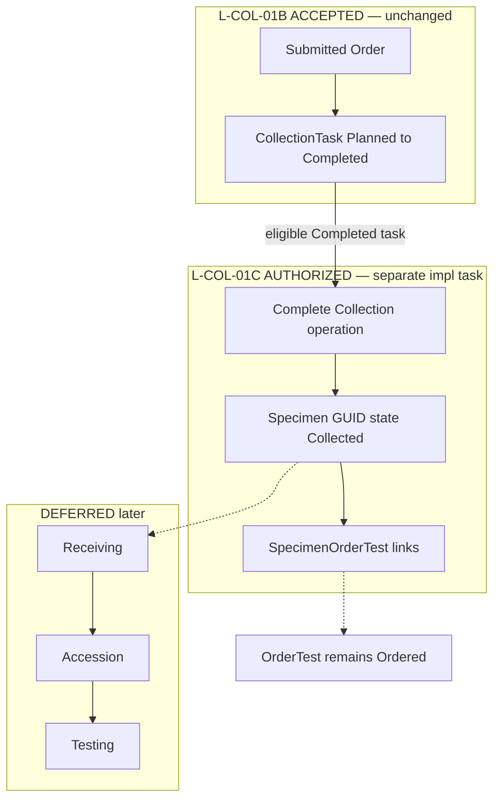

# L-COL-01A — Specimen & Receiving Product / Architecture Decision Closure

**Date:** 2026-10-10  
**Slice:** L-COL-01A (Specimen & Receiving decision closure — successor gate after accepted CollectionTask)  
**Mode:** DOCUMENTATION / PRODUCT OWNER APPROVAL ONLY — no application source, schema, migrations, APIs, UI, permissions seeding/grants, CollectionTask behavior, Orders, Catalogue, Pathology, Billing, Specimen, or Receiving implementation  
**Prior workshop baseline:** [enterprise-lms-collection-specimen-decision-closure.md](./enterprise-lms-collection-specimen-decision-closure.md)  
**Authoritative L-COL-01B acceptance:** [enterprise-lms-collection-task-acceptance-closure.md](./enterprise-lms-collection-task-acceptance-closure.md)  
**Authoritative L-COL-01B UAT:** [enterprise-lms-collection-task-final-uat-audit.md](./enterprise-lms-collection-task-final-uat-audit.md)

```text
L0 · L-CAT-01B · L-ORD-01B · L-ORD-01C · L-COL-01B  ← ACCEPTED
  ↓
PD-COL-SPC-* / AD-COL-SPC-* (THIS DOCUMENT)
  ← PRODUCT OWNER APPROVED (2026-10-10)
  ↓
L-COL-01C Specimen Foundation
  ← AUTHORIZED FOR SEPARATE IMPLEMENTATION TASK
  ← NOT IMPLEMENTED BY THIS DOCUMENT
  ↓
Later: Receiving / accession → Testing
```

---

## 1. Executive summary

L-COL-01B CollectionTask is **ACCEPTED** and **unchanged**. Its lifecycle remains:

`Planned → Ready → InProgress → Completed`

**CollectionTask `Completed` means the queue task is terminal. It does NOT create a Specimen.** That meaning is not rewritten.

Product Owner has **APPROVED** the Specimen & Receiving decisions below. **L-COL-01C is authorized as a bounded separate implementation task** and is **not** implemented by this document.

| Class | Meaning |
|---|---|
| **APPROVED** | Product Owner approved in this closure, or already certified upstream |
| **DEFERRED** | Explicitly out of L-COL-01C; later slice |
| **REJECTED** | None |

**Gate determination:**

# PRODUCT_DECISIONS_CLOSED_L_COL_01C_AUTHORIZED

**This document does not implement L-COL-01C.**

---

## 2. Authoritative upstream state (unchanged)

| Slice / constraint | Status |
|---|---|
| L0 LMS Foundation | **ACCEPTED** |
| L-CAT-01B Governed Catalogue | **ACCEPTED** |
| L-ORD-01B Order Domain | **ACCEPTED** |
| L-ORD-01C Orders UI | **ACCEPTED** |
| L-COL-01B CollectionTask + search/ownership | **ACCEPTED** — **must not be modified** |
| Pathology `/dashboard/laboratory` | **ACCEPTED** separate — not LMS Specimen SoT |
| Order: Draft → Submitted → Cancelled; OrderTest starts Ordered | **APPROVED** |
| Submit does not create CollectionTask / Specimen / accession / barcode / label / Receiving | **APPROVED** (PD-ORD-17) |
| CollectionTask `Completed` = queue terminal, **no Specimen** | **ACCEPTED** (L-COL-01B) |
| Collection ownership PD-COL-OWN-* | **APPROVED** |
| `lms.collection.view\|manage\|collect` | **ACCEPTED** — **must not be changed** |
| PD-LAB-BILL-01 / PD-LAB-PAY-01 baselines | **APPROVED** |

---

## 3. Evidence reviewed

| Document | Role |
|---|---|
| Prior revision of this file (`READY_FOR_PRODUCT_OWNER_APPROVAL`) | Decision package under review |
| L-COL-01B acceptance + final UAT audit | CollectionTask SoT |
| Prior Collection/Specimen workshop + discovery audit | Historical recommendations |
| L-ORD / L-CAT / BILL-PAY closures | Immutable upstream |

---

## 4. Authoritative Completion / Specimen boundary

**CRITICAL — Product Owner approved:**

```text
CollectionTask Completed
    ≠
Specimen Created

CollectionTask Completed
    +
explicit successful “Complete Collection” operation
    =
Specimen Created (state Collected)
```

| Rule | Detail |
|---|---|
| L-COL-01B `Completed` | Unchanged — queue task terminal; **does not** birth Specimen |
| L-COL-01C operation | Additive explicit **Complete Collection** against an **eligible Completed** CollectionTask |
| Effect | Creates Specimen (GUID, Collected); links to CollectionTask + OrderTests |
| Lifecycle | CollectionTask **remains** `Completed` — no status rewrite |
| Historical rows | Completed tasks without Specimen remain valid until Complete Collection is invoked |
| OrderTest | Remains `Ordered` — no state-machine change |

This distinction is mandatory for L-COL-01C: implementation docs, API design, automated tests, and UAT checklist.

---

## 5. Product Owner approved decisions — PD-COL-SPC-01 … PD-COL-SPC-22

### PD-COL-SPC-01 — Specimen ↔ OrderTest cardinality

| Field | Content |
|---|---|
| **Status** | **APPROVED** |
| **Rule** | M:N-capable via explicit LMS link. First runtime may create **1 Specimen → N OrderTests** (from CollectionTask associations). Schema must not prevent future **1 OrderTest → multiple Specimens** (recollection). Recollection UX **not** in L-COL-01C |

### PD-COL-SPC-02 — Specimen birth / Complete Collection

| Field | Content |
|---|---|
| **Status** | **APPROVED** |
| **Rule** | Specimen created only after successful collection completion via additive **Complete Collection** on eligible **Completed** CollectionTask. **Does not** change L-COL-01B Completed semantics. See §4 |

### PD-COL-SPC-03 — Specimen identity

| Field | Content |
|---|---|
| **Status** | **APPROVED** |
| **Rule** | Separate concepts: (1) Immutable Specimen GUID — **required in L-COL-01C** (2) Human/business specimen id — **DEFERRED** (3) Barcode — **DEFERRED** (4) Accession — **DEFERRED** until Receiving. No formats invented |

### PD-COL-SPC-04 — Accession timing

| Field | Content |
|---|---|
| **Status** | **APPROVED** |
| **Rule** | Accession at Receiving, not collection. Receiving implementation **DEFERRED**. L-COL-01C must **not** create accession |

### PD-COL-SPC-05 — Barcode and label

| Field | Content |
|---|---|
| **Status** | **APPROVED** (boundary) / implementation **DEFERRED** |
| **Rule** | Barcode ≠ accession. L-COL-01C does **not** implement barcode generation, label printing, printers, format, prefix, or check digit |

### PD-COL-SPC-06 — Collection site

| Field | Content |
|---|---|
| **Status** | **APPROVED** (already — L-COL-01B) |
| **Rule** | Platform Branch ID + optional `LocationText`. No new location hierarchy |

### PD-COL-SPC-07 — Patient identity

| Field | Content |
|---|---|
| **Status** | **APPROVED** |
| **Rule** | Specimen uses authoritative patient context from the Order. Successful Complete Collection requires confirmation of that patient context. Scanning/hardware **DEFERRED**. No new Patient masters |

### PD-COL-SPC-08 — Collector identity

| Field | Content |
|---|---|
| **Status** | **APPROVED** |
| **Rule** | Collector = authenticated platform user executing successful Complete Collection. No free-text collector. Witnessed-by **DEFERRED** |

### PD-COL-SPC-09 — Collection timestamp

| Field | Content |
|---|---|
| **Status** | **APPROVED** |
| **Rule** | Server UTC authoritative. Client time must never replace server time |

### PD-COL-SPC-10 — Collection outcome / failure

| Field | Content |
|---|---|
| **Status** | **APPROVED** for L-COL-01C success path |
| **Rule** | First Specimen slice supports **successful** collection path only. Failed/unable-to-collect path **DEFERRED**. No invented rejection/failure reason catalogue |

### PD-COL-SPC-11 — Recollection

| Field | Content |
|---|---|
| **Status** | **APPROVED** (mechanics) / UX **DEFERRED** |
| **Rule** | Specimens immutable. Future recollection → new CollectionTask + new Specimen + explicit prior-Specimen relationship. Full recollection UX **DEFERRED**. **Do not** modify OrderTest state semantics |

### PD-COL-SPC-12 — Custody

| Field | Content |
|---|---|
| **Status** | **DEFERRED** |
| **Rule** | No custody workflow in L-COL-01C. Architecture must not prevent future append-only specimen events |

### PD-COL-SPC-13 — Aliquots

| Field | Content |
|---|---|
| **Status** | **DEFERRED** |
| **Rule** | No aliquot workflow or master |

### PD-COL-SPC-14 — Referral / external specimens

| Field | Content |
|---|---|
| **Status** | **DEFERRED** |
| **Rule** | No receive-direct / external specimen workflows in L-COL-01C |

### PD-COL-SPC-15 — Ownership

| Field | Content |
|---|---|
| **Status** | **APPROVED** |
| **Rule** | Preserve L-COL-01B CollectionTask ownership. **No** Specimen Claim/Assign in L-COL-01C. Specimen custody responsibility later |

### PD-COL-SPC-16 — Specimen permissions

| Field | Content |
|---|---|
| **Status** | **APPROVED** (definitions only) |
| **Codes** | `lms.specimens.view` · `lms.specimens.manage` · `lms.specimens.receive` |
| **Constraints** | Do **not** seed role grants in decision tasks. Do **not** auto-assign to roles/users in this closure. Do **not** modify `lms.collection.*`. Production role mapping = separate decision. (Implementation task may seed **definitions** only when authorized — still no role grants unless separately approved) |

### PD-COL-SPC-17 — Receiving boundary

| Field | Content |
|---|---|
| **Status** | **APPROVED** |
| **Rule** | LaboratoryApi owns Specimen and Receiving. **No** Receiving microservice. Receiving implementation **DEFERRED**. Accession belongs to later Receiving capability |

### PD-COL-SPC-18 — Specimen state machine

| Field | Content |
|---|---|
| **Status** | **APPROVED** |
| **Rule** | L-COL-01C minimum Specimen state: **Collected**. Received / Rejected **DEFERRED** until Receiving slice. OrderTest remains **Ordered**. No OrderTest state-machine change |

### PD-COL-SPC-19 — Idempotency

| Field | Content |
|---|---|
| **Status** | **APPROVED** |
| **Rule** | Operation-specific Specimen idempotency. Do not reuse Order or CollectionTask idempotency stores/keys. Use LMS tenant + operation + request-hash pattern when L-COL-01C is implemented |

### PD-COL-SPC-20 — Concurrency

| Field | Content |
|---|---|
| **Status** | **APPROVED** |
| **Rule** | Optimistic concurrency: `RowVersion` / `ExpectedRowVersion` on mutable Specimen aggregates |

### PD-COL-SPC-21 — Audit

| Field | Content |
|---|---|
| **Status** | **APPROVED** |
| **Rule** | Platform `audit_log` sole SoT. Fail-closed LMS mutation pattern. Conceptual L-COL-01C actions: `CREATE_SPECIMEN`, `COMPLETE_COLLECTION`. Receiving actions **DEFERRED**. Allowlist/code only in L-COL-01C implementation task — **not** in this document |

### PD-COL-SPC-22 — Billing boundary

| Field | Content |
|---|---|
| **Status** | **APPROVED** |
| **Rule** | PD-LAB-BILL-01 remains authoritative (charge boundary = specimen collection). L-COL-01C: **no** Billing implementation, charge posting, payment gate, or Finance mutation. Future event/outbox **DEFERRED** |

---

## 6. Architecture decisions — AD-COL-SPC-01 … AD-COL-SPC-12

| ID | Title | Status |
|---|---|---|
| AD-COL-SPC-01 | LaboratoryApi owns Specimen and Receiving | **APPROVED** |
| AD-COL-SPC-02 | Shared PostgreSQL `hospitalportal` with LMS-owned `lms_*` tables | **APPROVED** |
| AD-COL-SPC-03 | Specimen GUID, accession, barcode are separate concepts | **APPROVED** |
| AD-COL-SPC-04 | Explicit M:N-capable Specimen ↔ OrderTest link | **APPROVED** |
| AD-COL-SPC-05 | Operation-specific Specimen idempotency | **APPROVED** |
| AD-COL-SPC-06 | Optimistic concurrency | **APPROVED** |
| AD-COL-SPC-07 | Platform `audit_log` + fail-closed LMS mutations | **APPROVED** |
| AD-COL-SPC-08 | Pathology specimen fields are NOT LMS Specimen SoT | **APPROVED** |
| AD-COL-SPC-09 | Catalogue specimen/container refs remain opaque until governed logistics master approved | **APPROVED** |
| AD-COL-SPC-10 | Staged: (1) CollectionTask ACCEPTED (2) Specimen Foundation = next impl candidate (3) Receiving/Accession later (4) Testing later | **APPROVED** |
| AD-COL-SPC-11 | No Receiving microservice | **APPROVED** |
| AD-COL-SPC-12 | Billing handoff future event/outbox; no Billing in L-COL-01C | **APPROVED** |

---

## 7. Decision register (compact)

| ID | Status |
|---|---|
| PD-COL-SPC-01 | **APPROVED** |
| PD-COL-SPC-02 | **APPROVED** |
| PD-COL-SPC-03 | **APPROVED** (business id / barcode / accession deferred as above) |
| PD-COL-SPC-04 | **APPROVED** |
| PD-COL-SPC-05 | **APPROVED** / impl **DEFERRED** |
| PD-COL-SPC-06 | **APPROVED** |
| PD-COL-SPC-07 | **APPROVED** |
| PD-COL-SPC-08 | **APPROVED** |
| PD-COL-SPC-09 | **APPROVED** |
| PD-COL-SPC-10 | **APPROVED** (success path); failure path **DEFERRED** |
| PD-COL-SPC-11 | **APPROVED** (mechanics); UX **DEFERRED** |
| PD-COL-SPC-12 | **DEFERRED** |
| PD-COL-SPC-13 | **DEFERRED** |
| PD-COL-SPC-14 | **DEFERRED** |
| PD-COL-SPC-15 | **APPROVED** |
| PD-COL-SPC-16 | **APPROVED** (definitions; no role grants) |
| PD-COL-SPC-17 | **APPROVED** |
| PD-COL-SPC-18 | **APPROVED** |
| PD-COL-SPC-19 | **APPROVED** |
| PD-COL-SPC-20 | **APPROVED** |
| PD-COL-SPC-21 | **APPROVED** |
| PD-COL-SPC-22 | **APPROVED** |
| AD-COL-SPC-01 … AD-COL-SPC-12 | **APPROVED** |

---

## 8. L-COL-01C authorization

| Field | Content |
|---|---|
| **Slice** | L-COL-01C — Specimen Foundation |
| **Authorization** | **AUTHORIZED FOR SEPARATE IMPLEMENTATION TASK** |
| **This document** | Does **not** implement L-COL-01C |
| **Next step** | Separate Cursor / engineering implementation task against this closure |

---

## 9. Exact L-COL-01C boundary

### IN SCOPE

- Specimen foundation tables owned by LaboratoryApi (`lms_*`)
- Explicit Specimen ↔ CollectionTask relationship
- Explicit M:N-capable Specimen ↔ OrderTest link
- Specimen immutable GUID
- Patient / Order / OrderTest references
- Collection Branch + optional LocationText (accepted collection model)
- Authenticated collector
- Server UTC collection timestamp
- Minimum Specimen state: **Collected**
- Explicit **Complete Collection** on eligible **Completed** CollectionTask
- Idempotency (Specimen-specific store)
- Optimistic concurrency
- Tenant + branch authorization
- Specimen permission **definitions** (`lms.specimens.view|manage|receive`) — **no role grants** unless separately approved
- Platform audit (`CREATE_SPECIMEN`, `COMPLETE_COLLECTION`)
- Read-only Specimen detail
- Automated tests

### OUT OF SCOPE

- Receiving · Accession · Barcode · Label printing · Printers  
- Custody · Aliquots · Referral/external specimens  
- Testing · Results · Verification · Authorization · Reporting  
- Billing execution · Payment gates  
- Production role grants · Staff picker · Specimen Claim/Assign  
- Pathology migration/sync · Pathology changes  
- OrderTest state changes  
- CollectionTask lifecycle changes · search changes · ownership changes  

---

## 10. Deferred capabilities (summary)

| Capability | Status |
|---|---|
| Receiving / accession | **DEFERRED** |
| Barcode / labels / printers / formats | **DEFERRED** |
| Human/business specimen identifier | **DEFERRED** |
| Failed/unable-to-collect path + reason codes | **DEFERRED** |
| Recollection UX | **DEFERRED** (schema must remain open) |
| Custody graph | **DEFERRED** |
| Aliquots | **DEFERRED** |
| Referral / external specimens | **DEFERRED** |
| Specimen Claim/Assign | **DEFERRED** / forbidden in L-COL-01C |
| Received / Rejected Specimen states | **DEFERRED** |
| Billing event/outbox / charge posting | **DEFERRED** |
| Testing | **DEFERRED** |
| Production role grants | Separate decision |

---

## 11. Traceability

| Upstream | Effect |
|---|---|
| L-COL-01B | Unchanged; Complete Collection is additive |
| L-ORD-01B / 01C | Unchanged; OrderTest stays Ordered |
| L-CAT-01B | Opaque logistics refs remain opaque (AD-COL-SPC-09) |
| Pathology | Not LMS Specimen SoT (AD-COL-SPC-08) |
| PD-LAB-BILL-01 | Principle retained; no Billing in L-COL-01C |

---

## 12. Specimen lifecycle diagram (APPROVED staging)



**Collected ≠ Received.** Accession only at Receiving (later).

---

## 13. Security / audit / billing (approved boundaries)

| Area | Rule |
|---|---|
| Tenant / branch | JWT tenant; platform Branch IDs |
| Collection permissions | Unchanged |
| Specimen permissions | Definitions APPROVED; no role grants in this closure |
| Audit | `audit_log` fail-closed; conceptual `CREATE_SPECIMEN` / `COMPLETE_COLLECTION` |
| Billing | BILL-01 principle only; no Finance mutation in L-COL-01C |

---

## 14. Confirmation — this task

- NO APPLICATION IMPLEMENTATION  
- NO DATABASE / MIGRATION  
- NO API IMPLEMENTATION  
- NO UI IMPLEMENTATION  
- NO SPECIMEN IMPLEMENTATION  
- NO RECEIVING IMPLEMENTATION  
- NO BILLING IMPLEMENTATION  
- NO ROLE GRANTS  
- NO PATHOLOGY CHANGES  
- NO ORDERS / CATALOGUE CHANGES  
- NO L-COL-01B BEHAVIOR CHANGES  

---

## FINAL STATUS

**PRODUCT_DECISIONS_CLOSED_L_COL_01C_AUTHORIZED**

**L-COL-01C = AUTHORIZED FOR SEPARATE IMPLEMENTATION TASK**

**STOP.** Do not implement L-COL-01C in this task.
